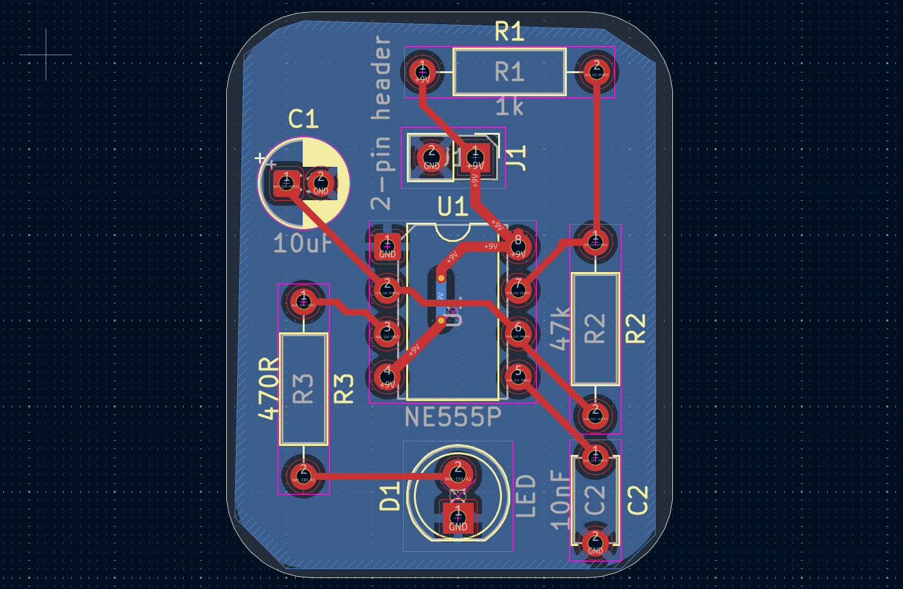
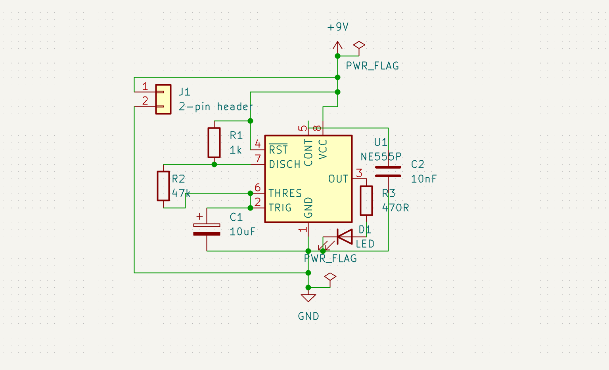

# 555 Timer LED Blinker PCB

A compact, 2-layer Printed Circuit Board (PCB) designed in KiCad using the classic NE555 timer IC configured in an astable multivibrator circuit to blink an LED.



## Overview

* **Board Dimensions:** ~26mm × 33mm
* **Layer Count:** 2 Layers (`F.Cu` signals, `B.Cu` solid ground plane)
* **Design Tool:** KiCad 8.0+
* **Technology:** Through-Hole Technology (THT)

## Schematic & Design

The circuit uses the 555 timer in astable mode to continuously generate square wave pulses, turning the onboard LED on and off at a frequency set by the RC timing network.



### Core Components
* **NE555 Timer IC** (DIP-8)
* **Timing Resistors ($R_1, R_2$) & Capacitor ($C_1$)** for frequency control
* **Output LED & Current-Limiting Resistor**
* **Power & Ground Header Pins**

## Repository Structure

```text
├── 555-LED-Blinker.kicad_pro   # KiCad Project file
├── 555-LED-Blinker.kicad_sch   # Schematic design
├── 555-LED-Blinker.kicad_pcb   # PCB layout design
├── pcb.png                     # Board layout render
├── schematic.png               # Schematic export
└── .gitignore                  # KiCad ignore rules
```

## How to Open & Modify

1. Clone this repository:
   ```bash
   git clone https://github.com/NotBrendanB/555-LED-Blinker.git
   ```
2. Open `555-LED-Blinker.kicad_pro` inside **KiCad**.
